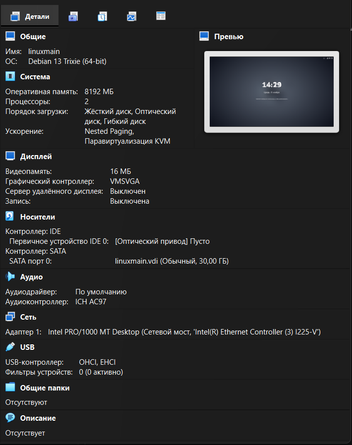
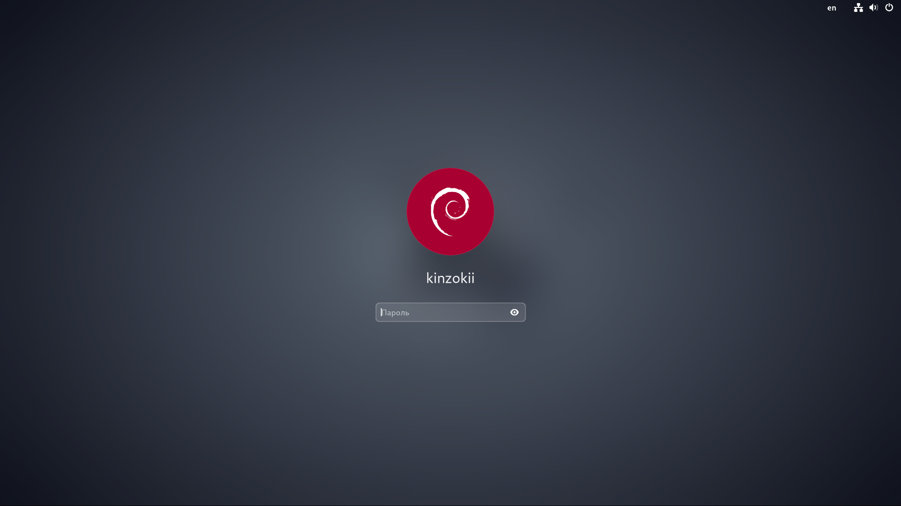
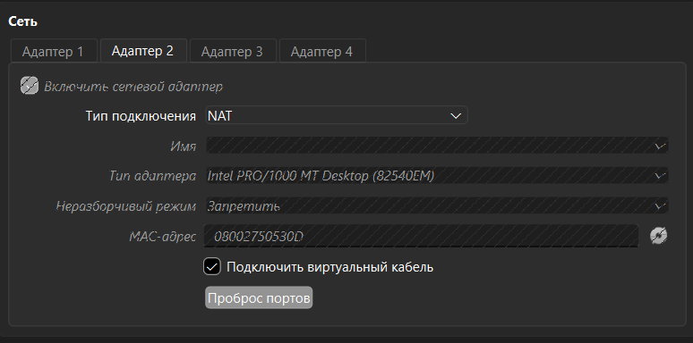
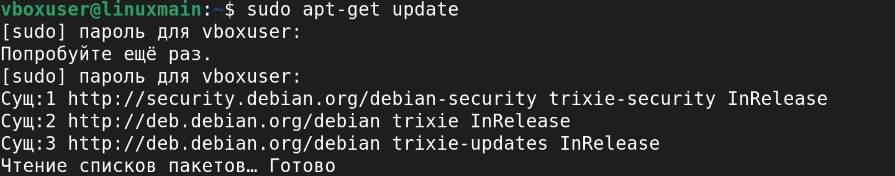
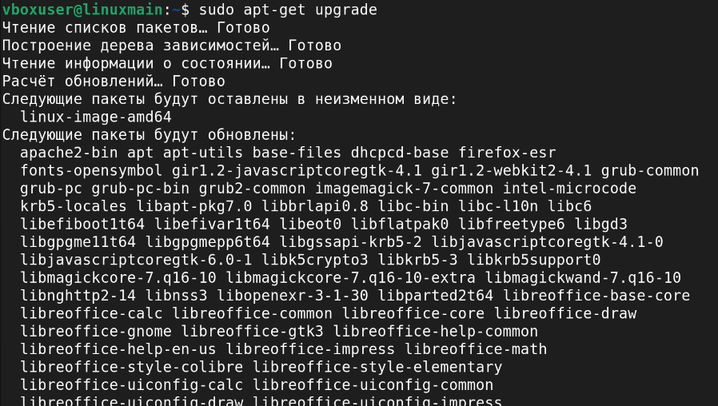
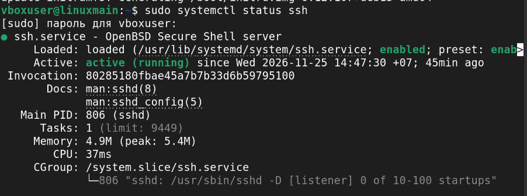

# Лабораторная работа №1. Введение в виртуальные машины и установка Debian.

Цель работы: создать виртуальную машину, создать и настроить операционную систему Linux Debian, научиться работать с терминалом Linux, установить и настроить SSH-сервер.

## 1. Установка виртуальной машины

В качестве ПО для создания и запуска виртуальной машины был выбран VirtualBox. Я выбрал его потому что он прост для начинающих и он кроссплатформенный, что для меня не менее важно.

Я создал виртуальную машину и выделил для неё 8 ГБ оперативной памяти, 2 ядра ЦП и 30 ГБ жесткого диска.

**Скриншот 1. Характеристики виртуальной машины**

## 2. Установка Debian

Я установил Debian Linux из ISO-образа https://www.debian.org/ . После этого в самой системе я настроил время, язык, имя системы, создал пользователя и задал пароль

**Скриншот 2. Пользователь и пароль**

## 3. Обновление системы

Для того чтобы чтобы система получила выход в интернет было настроен NAT.

**Скриншот 3. Сеть**

Далее я обновил систему

**Скриншот 4. Выполнение команды update**

**Скриншот 5. Выполнение команды upgrade**

`apt-get update`  - обновляет список пакетов, `apt-get upgrade`  - обновляет сами пакеты. `sudo` применяется потому что обновление пакетов изменяет системные файлы и каталоги, доступные только суперпользователю(root), обычный пользователь не имеет права изменять эти части системы.

## 4. Настройка SSH-сервера

Для начала нееобходимо установить пакеты для работы с SSH: `sudo apt-get install openssh-server` 

Далее необходимо включить SSH-сервер, это можно сделать командой `sudo systemctl enable --now ssh`

Проверить запущен ли сейчас SSH-сервер можно командой `sudo systemctl status ssh`

**Скриншот 6. Проверка работы SSH-сервера**

Для подключения к виртуальной машине под пользователем vboxuser по IP адресу сетевого моста (192.168.50.91) с Windows (через PowerShell) использовалась команда `ssh vboxuser@192.168.50.91`

## 5. Вход по SSH ключу

Командой `ssh-keygen -t ed25519` была сгенерирована пара SSH ключей на Windows, эти ключи сохраняются в `C:\Users\matve\.ssh`